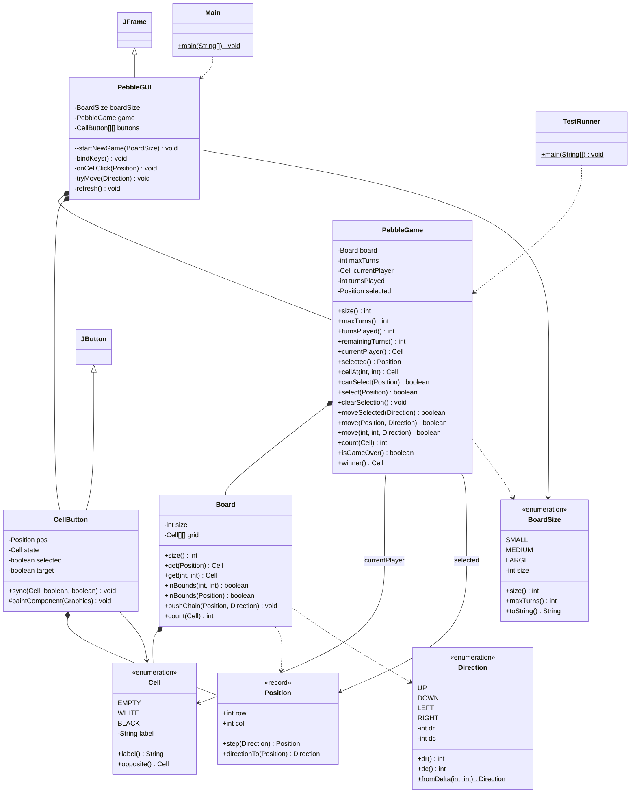

# Pebble Game

## Task

Two-player board game played on an $n \times n$ grid:

- At the start of a match, $n$ white and $n$ black pebbles are placed on the board at random positions. White goes first.
- Players take turns picking one of their own pebbles and moving it 1 step horizontally or vertically (`UP`, `DOWN`, `LEFT`, `RIGHT`).
- Moving into an occupied neighbour pushes the entire contiguous line of pebbles in that direction by 1 cell. If the last pebble in the pushed chain sits on the board edge, it falls off the board and is lost.
- Selectable board sizes:
  - $3 \times 3 \rightarrow 15$ turns ($5n$)
  - $4 \times 4 \rightarrow 20$ turns ($5n$)
  - $6 \times 6 \rightarrow 30$ turns ($5n$)
- The match ends after $5n$ turns (or immediately if a player loses all of their pebbles). Whoever has more pebbles left on the board wins; equal pebble counts result in a draw. A message dialog announces the result and a new game starts automatically.

## Architecture (Model vs. View)

The project is split into two halves inside the `pebble` package:

1. **Headless Game Model** (zero Swing imports — runs directly in terminal/tests):
   - `Cell` — what can sit on a square (`EMPTY`, `WHITE`, `BLACK`), plus `opposite()` to flip turns.
   - `Direction` — the 4 orthogonal steps (`UP`, `DOWN`, `LEFT`, `RIGHT`) with row/col deltas `(dr, dc)` and `fromDelta(dr, dc)` to map two adjacent cells to a direction.
   - `BoardSize` — the 3 selectable presets ($3\times 3 \rightarrow 15$ turns, $4\times 4 \rightarrow 20$ turns, $6\times 6 \rightarrow 30$ turns).
   - `Position` — immutable `(row, col)` Java `record` with `step(dir)` and `directionTo(target)`.
   - `Board` — owns the $n \times n$ `Cell[][]` array, random setup, and the chain-push algorithm.
   - `PebbleGame` — owns the game rules: active player, selected pebble, turn counter, and win/draw detection.

2. **Swing GUI (View + Event Handlers)**:
   - `CellButton` — custom `JButton` subclass that overrides `paintComponent(Graphics)` to draw checkerboard squares, green/blue highlight borders, and white/black pebbles.
   - `PebbleGUI` — `JFrame` window that wires mouse clicks, keyboard shortcuts, board size dropdown, and the end-of-game popup to `PebbleGame`.
   - `Main` — starts `PebbleGUI` on the Swing Event Dispatch Thread (`SwingUtilities.invokeLater`).

## How the Core Logic Works

### 1. Random Setup (`Board(int size, Random rng)`)

Creates a list of all $n^2$ coordinates, calls `Collections.shuffle(spots, rng)`, and puts `WHITE` on the first $n$ coordinates and `BLACK` on the next $n$ coordinates so $n$ white and $n$ black pebbles never overlap. A second constructor `Board(Cell[][] src)` accepts a fixed grid for deterministic tests.

### 2. Chain-Push Mechanics (`Board.pushChain(Position start, Direction dir)`)

When a pebble at `start` moves in `dir`, it pushes any contiguous line of pebbles directly in front of it, stopping at the first `EMPTY` square (or the board edge):

1. **Find the end of the contiguous chain**:

   ```java
   Position end = start;
   while (inBounds(end.step(dir)) && get(end.step(dir)) != Cell.EMPTY) {
       end = end.step(dir);
   }
   ```

   If `(0,0)=W`, `(0,1)=B`, `(0,2)=EMPTY`, `(0,3)=B` and we push `(0,0)` `RIGHT`, `end` stops at `(0,1)` because `(0,2)` is empty. The pebble at `(0,3)` is across a gap, so it stays untouched.

2. **Handle the tail pebble (in-bounds vs. fall-off)**:

   ```java
   Position after = end.step(dir);
   if (inBounds(after)) {
       grid[after.row()][after.col()] = get(end);
   }
   ```

   If `after` is inside the board, the tail pebble moves into that empty spot. If `after` is outside the board (`!inBounds(after)`), `get(end)` is not copied anywhere and gets overwritten in step 3 — meaning **it falls off the edge of the board**.

3. **Shift the chain backward from `end` to `start`**:
   ```java
   for (Position cur = end; !cur.equals(start); ) {
       Position prev = new Position(cur.row() - dir.dr(), cur.col() - dir.dc());
       grid[cur.row()][cur.col()] = get(prev);
       cur = prev;
   }
   grid[start.row()][start.col()] = Cell.EMPTY;
   ```
   Copying backwards (`end <- end-1 <- ... <- start`) shifts every pebble 1 step forward without overwriting anything, then clears `start` to `EMPTY`.

### 3. Turn & Win Rules (`PebbleGame`)

- **Selection (`canSelect` / `select`)**: A player can only select a cell if `!isGameOver()` and `board.get(pos) == currentPlayer`.
- **Executing a Move (`move(Position start, Direction dir)`)**: Checks `canSelect(start)` and `board.inBounds(start.step(dir))` (so a player on the border cannot accidentally push their own pebble straight off the board into nothing when pressing an arrow key; only pushed neighbours at the end of a chain fall off). Then it runs `board.pushChain(start, dir)`, clears `selected`, increments `turnsPlayed`, and flips `currentPlayer = currentPlayer.opposite()`.
- **Game Over & Winner (`isGameOver()`, `winner()`)**: Ends when `turnsPlayed >= maxTurns` ($5n$) or when either player hits `0` pebbles. Compares `count(Cell.WHITE)` vs `count(Cell.BLACK)` and returns `WHITE`, `BLACK`, or `EMPTY` (draw).

### 4. Swing GUI & Event Flow (`PebbleGUI` & `CellButton`)

- **Window Sizing (`pack()`)**: In `startNewGame(BoardSize preset)`, an $n \times n$ `GridLayout` of `CellButton`s (each `84x84` px preferred size) is placed into `boardContainer` followed by `pack()`, resizing the `JFrame` tightly around $3\times 3$, $4\times 4$, or $6\times 6$ every time.
- **Two Ways to Move a Pebble**:
  - **Mouse**: Click one of your pebbles $\rightarrow$ `onCellClick` selects it and highlights its orthogonal neighbours in blue. Click any highlighted neighbour $\rightarrow$ `sel.directionTo(clicked)` resolves the `Direction` and calls `tryMove(dir)`. (Clicking the selected pebble again deselects it.)
  - **Keyboard**: Select one of your pebbles, then press `W`/`A`/`S`/`D` or the Arrow keys $\rightarrow$ Swing's `InputMap`/`ActionMap` in `bindKeys()` triggers `tryMove(dir)`.
- **End-of-Game Popup & Auto-Restart**: Inside `tryMove(dir)`, if `game.isGameOver()` is true after a move, `JOptionPane.showMessageDialog` announces the winner (or draw) with final pebble counts and immediately calls `startNewGame(boardSize)`.

## Class Diagram



## Methods Overview

| Class        | Method                                   | Description                                                                                                                         |
| ------------ | ---------------------------------------- | ----------------------------------------------------------------------------------------------------------------------------------- |
| `Cell`       | `opposite()`                             | Flips `WHITE` $\leftrightarrow$ `BLACK`, leaves `EMPTY` as `EMPTY`.                                                                 |
| `Direction`  | `fromDelta(dr, dc)`                      | Maps a 1-step orthogonal `(dr, dc)` offset to its `Direction`, or `null`.                                                           |
| `BoardSize`  | `maxTurns()`                             | Returns $5n$ turns for board dimension $n$.                                                                                         |
| `Position`   | `step(dir)`                              | Returns the neighboring coordinate one step in `dir`.                                                                               |
| `Position`   | `directionTo(target)`                    | Returns the orthogonal `Direction` to `target` if adjacent, else `null`.                                                            |
| `Board`      | `inBounds(...)`                          | Checks whether coordinates lie inside $[0, n) \times [0, n)$.                                                                       |
| `Board`      | `pushChain(start, dir)`                  | Shifts the contiguous line of pebbles from `start` one step in `dir`; drops the tail pebble if pushed off the edge.                 |
| `Board`      | `count(color)`                           | Counts pebbles of `color` remaining on the board.                                                                                   |
| `PebbleGame` | `canSelect(pos)`                         | True when the game is running and `pos` holds the current player's pebble.                                                          |
| `PebbleGame` | `select(pos)` / `clearSelection()`       | Sets or clears the selected pebble coordinate.                                                                                      |
| `PebbleGame` | `move(start, dir)` / `moveSelected(dir)` | Validates the step, calls `Board.pushChain`, increments turns, and flips the active player.                                         |
| `PebbleGame` | `isGameOver()`                           | True when `turnsPlayed >= maxTurns` ($5n$) or either color reaches `0` pebbles.                                                     |
| `PebbleGame` | `winner()`                               | Returns the color with more pebbles on the board, or `Cell.EMPTY` on a draw.                                                        |
| `CellButton` | `sync(state, selected, target)`          | Updates tile state/highlights from the model and repaints.                                                                          |
| `CellButton` | `paintComponent(g)`                      | Draws the checkerboard tile, highlight border, and pebble disc.                                                                     |
| `PebbleGUI`  | `startNewGame(preset)`                   | Rebuilds the $n \times n$ `CellButton` grid and calls `pack()` so the window fits the board.                                        |
| `PebbleGUI`  | `onCellClick(clicked)`                   | Deselects on re-click, pushes if `clicked` is adjacent to the selected pebble, or selects a pebble.                                 |
| `PebbleGUI`  | `tryMove(dir)`                           | Runs `game.moveSelected(dir)`, refreshes the UI, and shows the `JOptionPane` winner/draw dialog + auto-restarts when the game ends. |
| `PebbleGUI`  | `refresh()`                              | Syncs all `CellButton` cells and the status label with `PebbleGame`.                                                                |

| Class        | Method                                   | Description                                                                                                                         |
| ------------ | ---------------------------------------- | ----------------------------------------------------------------------------------------------------------------------------------- |
| `Cell`       | `opposite()`                             | Flips `WHITE` $\leftrightarrow$ `BLACK`, leaves `EMPTY` as `EMPTY`.                                                                 |
| `Direction`  | `fromDelta(dr, dc)`                      | Maps a 1-step orthogonal `(dr, dc)` offset to its `Direction`, or `null`.                                                           |
| `BoardSize`  | `maxTurns()`                             | Returns $5n$ turns for board dimension $n$.                                                                                         |
| `Position`   | `step(dir)`                              | Returns the neighboring coordinate one step in `dir`.                                                                               |
| `Position`   | `directionTo(target)`                    | Returns the orthogonal `Direction` to `target` if adjacent, else `null`.                                                            |
| `Board`      | `inBounds(...)`                          | Checks whether coordinates lie inside $[0, n) \times [0, n)$.                                                                       |
| `Board`      | `pushChain(start, dir)`                  | Shifts the contiguous line of pebbles from `start` one step in `dir`; drops the tail pebble if pushed off the edge.                 |
| `Board`      | `count(color)`                           | Counts pebbles of `color` remaining on the board.                                                                                   |
| `PebbleGame` | `canSelect(pos)`                         | True when the game is running and `pos` holds the current player's pebble.                                                          |
| `PebbleGame` | `select(pos)` / `clearSelection()`       | Sets or clears the selected pebble coordinate.                                                                                      |
| `PebbleGame` | `move(start, dir)` / `moveSelected(dir)` | Validates the step, calls `Board.pushChain`, increments turns, and flips the active player.                                         |
| `PebbleGame` | `isGameOver()`                           | True when `turnsPlayed >= maxTurns` ($5n$) or either color reaches `0` pebbles.                                                     |
| `PebbleGame` | `winner()`                               | Returns the color with more pebbles on the board, or `Cell.EMPTY` on a draw.                                                        |
| `CellButton` | `sync(state, selected, target)`          | Updates tile state/highlights from the model and repaints.                                                                          |
| `CellButton` | `paintComponent(g)`                      | Draws the checkerboard tile, highlight border, and pebble disc.                                                                     |
| `PebbleGUI`  | `startNewGame(preset)`                   | Rebuilds the $n \times n$ `CellButton` grid and calls `pack()` so the window fits the board.                                        |
| `PebbleGUI`  | `onCellClick(clicked)`                   | Deselects on re-click, pushes if `clicked` is adjacent to the selected pebble, or selects a pebble.                                 |
| `PebbleGUI`  | `tryMove(dir)`                           | Runs `game.moveSelected(dir)`, refreshes the UI, and shows the `JOptionPane` winner/draw dialog + auto-restarts when the game ends. |
| `PebbleGUI`  | `refresh()`                              | Syncs all `CellButton` cells and the status label with `PebbleGame`.                                                                |

## Events and Event Handlers

| Event Source                                    | Event                      | Handler in `PebbleGUI`    | Effect                                                                                                    |
| ----------------------------------------------- | -------------------------- | ------------------------- | --------------------------------------------------------------------------------------------------------- |
| `CellButton[r][c]`                              | `ActionEvent` (click)      | `onCellClick(pos)`        | Selects/deselects a pebble at `pos`, or pushes the selected pebble toward `pos` if orthogonally adjacent. |
| Root pane key map (`W`/`A`/`S`/`D`, Arrow keys) | `KeyEvent` / `ActionEvent` | `tryMove(dir)`            | Pushes the selected pebble in `dir`.                                                                      |
| `sizeBox` (`JComboBox<BoardSize>`)              | `ActionEvent`              | `startNewGame(chosen)`    | Starts a fresh game at $3\times 3$, $4\times 4$, or $6\times 6$ and resizes the window via `pack()`.      |
| `New Game` button                               | `ActionEvent`              | `startNewGame(boardSize)` | Resets the board and turn counter at the current board size.                                              |
| Event Source                                    | Event                      | Handler in `PebbleGUI`    | Effect                                                                                                    |
| ---                                             | ---                        | ---                       | ---                                                                                                       |
| `CellButton[r][c]`                              | `ActionEvent` (click)      | `onCellClick(pos)`        | Selects/deselects a pebble at `pos`, or pushes the selected pebble toward `pos` if orthogonally adjacent. |
| Root pane key map (`W`/`A`/`S`/`D`, Arrow keys) | `KeyEvent` / `ActionEvent` | `tryMove(dir)`            | Pushes the selected pebble in `dir`.                                                                      |
| `sizeBox` (`JComboBox<BoardSize>`)              | `ActionEvent`              | `startNewGame(chosen)`    | Starts a fresh game at $3\times 3$, $4\times 4$, or $6\times 6$ and resizes the window via `pack()`.      |
| `New Game` button                               | `ActionEvent`              | `startNewGame(boardSize)` | Resets the board and turn counter at the current board size.                                              |

## Testing

`TestRunner` runs 5656 checks across 44 test suites (including a 1,000-game / 21,565-move property-based stress test) and exits non-zero on failure:

- `testPresetsAndInit` — verifies $3\times 3 \rightarrow 15$, $4\times 4 \rightarrow 20$, $6\times 6 \rightarrow 30$ turn limits, random placement counts ($n$ white, $n$ black, $n^2-2n$ empty), and initial turn state.
- `testMoveAndPushMechanics` — verifies pushing horizontal and vertical chains into an empty gap without moving pebbles beyond the gap, turn alternation, and pushing edge pebbles off the board.
- `testRulesAndEndConditions` — verifies invalid move rejection (empty cell, opponent pebble, self-push off edge, null inputs), `select`/`moveSelected`, draw at `maxTurns`, early victory when the opponent loses their last pebble, and exception guards.
- `testAlgebraicStressFuzz` — simulates 1,000 full games (`21,565` moves) across $3\times 3$, $4\times 4$, and $6\times 6$ boards, verifying on every move that off-ray cells and beyond-gap cells are untouched, contiguous chain cells shift by 1 step, pebble conservation/edge fall-off holds, and termination invariants match.

- `testMoveAndPushMechanics` — verifies pushing horizontal and vertical chains into an empty gap without moving pebbles beyond the gap, turn alternation, and pushing edge pebbles off the board.
- `testRulesAndEndConditions` — verifies invalid move rejection (empty cell, opponent pebble, self-push off edge, null inputs), `select`/`moveSelected`, draw at `maxTurns`, early victory when the opponent loses their last pebble, and exception guards.
- `testAlgebraicStressFuzz` — simulates 1,000 full games (`21,565` moves) across $3\times 3$, $4\times 4$, and $6\times 6$ boards, verifying on every move that off-ray cells and beyond-gap cells are untouched, contiguous chain cells shift by 1 step, pebble conservation/edge fall-off holds, and termination invariants match.

## Build and Run

```bash
./run.sh          # Compiles & launches the Swing GUI
./run.sh test     # Compiles & runs the automated test suite (5656 checks)
./run.sh build    # Compiles all classes into bin/ with -Xlint:all
./run.sh clean    # Removes bin/
```
